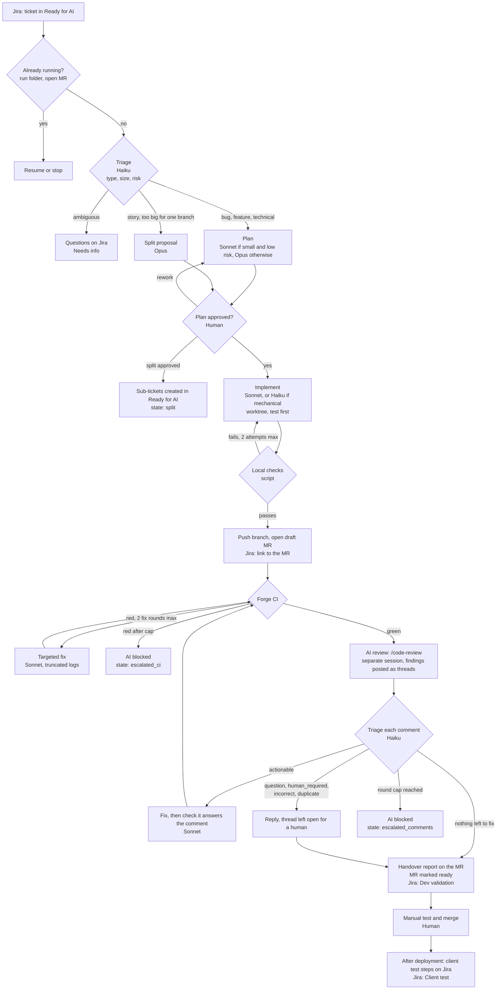

# Architecture

This is the merged design: plan A's local plugin and token levers, with plan B's scope, CI gate, early draft, failure states and comment rules. [comparison.md](comparison.md) explains where each idea comes from.

GitLab is the main forge, GitHub the second one. These documents say merge request (MR), which is a pull request on GitHub.

Jira statuses are deferred. Version 1 reads tickets and posts comments, and never changes a status. Every status move this document mentions, in the diagram, the stages and [Jira statuses](#jira-statuses), is the proposal for later.

## Principles

The plan carries the intelligence. A strong model pays for the thinking once, and the cheaper models only execute what the plan spells out. If a change cannot be described in full (files, helpers to reuse, expected behaviour, tests), it is not a job for Haiku.

Free checks come before paid ones. Lint, type checks, unit tests and the build run before any model reviews anything.

The forge's CI is the truth. Local checks catch most errors cheaply, but only CI proves the branch works in the real pipeline. The AI review waits for a green CI.

Every loop has a cap. Runaway retries and bot-to-bot ping-pong are what blow up a bill, not the happy path.

Every run ends in a named state. Nothing stops silently.

State lives on disk. Agents receive file paths, not pasted content, and any stage can be rerun on its own.

Humans approve the plan and test the result. Everything between those two points is automated.

## The flow



## Stages

| # | Stage | Who | Output | Stops when |
|---|-------|-----|--------|------------|
| 0 | Repository profile | Opus, once per repository | `.claude/ticket-flow.md` | profile reviewed and committed |
| 1 | Pick up and triage | script, then Haiku | `triage.json`, or questions on Jira | ticket usable, parked, or flagged as a story |
| 2 | Plan or split proposal | Sonnet or Opus | `plan.json` | plan written and posted on Jira |
| 3 | Plan gate | Human | approval, rework notes, or approved split | approved |
| 4 | Implement | Sonnet or Haiku | commits on the ticket branch, five-line report | local checks pass, or attempt cap |
| 5 | Local checks | script | pass, or truncated error output | pass |
| 6 | Draft MR | `forge.sh` | pushed branch, draft MR, link on Jira | MR open |
| 7 | CI gate | forge CI, Sonnet for fixes | green pipeline | green, or fix round cap |
| 8 | AI review | `/code-review` in a separate session | findings posted as MR threads | findings posted |
| 9 | Comment loop | Haiku triage, Sonnet fixes and checks | fixes, replies, resolved threads | nothing left to fix, or round cap |
| 10 | Handover | Sonnet | MR comment, draft client steps, MR ready | human tests and merges |
| 11 | Client steps | Human runs one command | Jira comment, Client test status | client tests |

### 0. Repository profile

A committed file, `.claude/ticket-flow.md`, holds what every agent would otherwise rediscover: the forge, the commands for install, lint, type check, test and build, the base branch, the branch pattern, the protected branches, the Jira project and its statuses, the API client, and a short map of the modules. This file is what lets the same plugin work on any web project, and it removes the most expensive habit of a fresh agent, which is exploring the repository from scratch.

### 1. Pick up and triage

A script checks first, at no model cost. If the ticket already has a run folder, or an open MR on a branch carrying its key, the flow offers to resume instead of starting again. This gives one run and one MR per ticket. Once statuses are added, the ticket will also move to AI in progress, which tells colleagues that someone's flow has taken it.

Haiku then reads the ticket and writes `triage.json`:

```json
{
  "ticket": "SHOP-142",
  "type": "feature",
  "summary": "Apply a percentage discount code at checkout",
  "acceptance": ["A valid code lowers the total", "An invalid code shows an error", "The total never goes below zero"],
  "likely_files": ["src/cart/", "src/checkout/"],
  "risk": ["migration"],
  "ambiguities": [],
  "size": "medium",
  "decision": "continue"
}
```

The type changes what happens next:

| Type | What the flow does |
|------|--------------------|
| `bug` | The plan starts with a test that reproduces the bug and fails. If the bug cannot be reproduced, the ticket goes to Needs info with what was tried. |
| `feature` | The plan follows the acceptance criteria, one test per criterion at least. |
| `technical` | Refactoring, configuration, dependency upgrades, documentation. No behaviour change is expected, so existing tests must stay green. The handover puts weight on configuration and infrastructure. |
| `story` | Too big for one branch. The planner proposes a split into sub-tickets instead of a plan. |

The decision is `continue`, `needs_info` (questions posted on Jira, ticket moves to Needs info) or `split`.

No category is excluded in version 1, because the pilot has to see every kind of ticket. Risk signals (migration, authentication, permissions, payment, dependency upgrade, sensitive directory) do not stop a ticket. They raise the planner to Opus, keep Haiku off the implementation, and become critical points in the handover report.

### 2. Plan or split proposal

The planner runs as a subagent on the model triage chose: Sonnet for a small, low-risk ticket without ambiguity, Opus for the rest and for every split. It reads the ticket, `triage.json` and the code the ticket touches, then writes `plan.json`. This routing rule is my guess and gets checked on the pilot tickets.

For a story, the planner proposes sub-tickets instead: each with a title, its own acceptance criteria, the files it touches, and its order. Each sub-ticket must be small enough for one MR.

### 3. Plan gate

The plan or the split is posted as a Jira comment and summarised in the session, and the ticket moves to Plan review. The developer approves it or writes rework notes. The gate is on by default. With `--auto-approve`, a plan whose open points are empty passes without asking, and the log says `auto-approved`. A split always waits.

An approved split ends the run in the `split` state. The flow creates the sub-tickets on Jira in Ready for AI, links them to the story, and leaves the story itself to the team. Each sub-ticket then goes through the flow on its own branch.

### 4. Implement

One agent, in the ticket's git worktree, working test first. The skill creates the worktree outside the repository, at `<repository parent>/<repository name>.worktrees/<KEY>`, with the branch cut from `origin/<base>` explicitly. Every later fix for the ticket happens in the same worktree. It runs unit tests and type checks only. Anything that needs a shared service (database, fixed port, dev server) is left to the orchestrator. It commits locally and reports in five lines at most, plus the `not_tested` and `known_limits` fields the handover needs.

The executor is Sonnet by default, Haiku when the plan marks the change as mechanical and triage found no risk.

### 5. Local checks

The profile's commands run after the agent finishes, through `checks.sh`. On failure the agent gets the tail of the error output, not the whole log. Two attempts per failing check, then the run ends in `escalated_checks`.

### 6. Draft MR

`forge.sh` pushes the branch and opens a draft MR from a template: Jira link, the problem, the behaviour after the change, the local checks that actually ran and on which commit, what was tested and what was not, and a folded "AI and details" section with the plan's files and risks for the reviewers. The draft goes up before CI, so CI runs on it and the team can see the work without mistaking it for finished work. The MR link is added to the Jira ticket.

### 7. CI gate

The flow waits for the pipeline with the Monitor tool. A manual, skipped or canceled pipeline gave no result: it is neither a success nor a bug, and the run escalates. On a red pipeline, the flow first reads the log and sorts the failure: a test that ran and found a wrong result (`code`), a job that did not start (`environment`), a doubt on the expected result (`expectation`), or no usable log (`missing`). Only `code`, or an environment the change itself broke, gets a fix: Sonnet gets the failed job's name and the tail of its log, makes a targeted fix, runs the local checks and pushes. The commit the green pipeline ran on is recorded as `ci_sha`. Two fix rounds, then the run ends in `escalated_ci` and the ticket moves to AI blocked.

### 8. AI review

Once CI is green, the flow records the commit it reviews as `reviewed_sha`, then a separate non-interactive session (`command claude -p --model sonnet "/code-review medium origin/<base>...HEAD"`, run in the worktree) reviews the branch. It shares nothing with the session that wrote the code. The flow reads the findings from the session's output and posts each one as a thread on the changed line through `forge.sh`, in one format: severity, location, evidence, suggested action. A finding without evidence is posted as a remark and does not block.

The flow posts the threads itself instead of using `/code-review --comment`, for two reasons. On GitLab, `--comment` writes one note for the whole review, and one note cannot be resolved finding by finding. And the comment watcher ignores comments written by the logged-in user, so it would not see them anyway.

If the team already has a review bot, its comments enter the comment loop like any other. The flow does not add a second paid review on top.

### 9. Comment loop

The loop handles the AI review's findings, plus any comment written by a person or a bot while the run is alive. Haiku checks each comment against the current code, and checks the diagnosis and the suggested fix separately: a reviewer can find the right problem and suggest the wrong fix. Contradicting comments stay visible as a decision for a human. Then it sorts each one into five categories:

| Category | What the flow does | Thread |
|----------|-------------------|--------|
| `actionable` | Sonnet fixes it, local checks and CI run again, then a read-only Sonnet agent checks that the fix answers the comment. The flow replies with what changed. | resolved once the check passes |
| `question` | Replies with what it knows, and lists it for a human in the handover | left open |
| `human_required` | A product or design choice. Lists it for a human. | left open |
| `incorrect` | Replies with the reason it thinks the comment is wrong | left open |
| `duplicate` | Replies with a link to the other thread | left open |

The flow only resolves threads it fixed and checked. Every other thread stays open for a human.

Caps: one fix attempt per comment, two rounds overall. A fix that fails its check leaves the thread open with a note. Past the round cap, the run ends in `escalated_comments`.

### 10. Handover

Before writing, the handover checks that the last green pipeline ran on the final commit, lists the commits made after the AI review, and picks the review route: `human` when the change touches a risk path, access rights, private data, payment, a business calculation or configuration, or leaves a decision open, `ai` otherwise. The route sets how deep the human reading must be. It never allows a merge.

Sonnet writes the handover comment on the MR from the run's own files: what the MR does in plain language, what changed, how to test it by hand, the points of attention, the open threads, and a checklist before merging. It also drafts the client test steps. Then the MR is marked ready and the ticket moves to Dev validation. The full template is in [handover-report.md](handover-report.md).

### 11. Client steps

After the merge and the deployment to the test environment, the developer reads the client steps and runs `/ticket-flow:handover SHOP-142 --publish`. The steps go on the Jira ticket and the ticket moves to Client test.

## End states

Every run writes one of these to `log.jsonl`. The Jira status column applies once statuses are added.

| State | Meaning | Jira status |
|-------|---------|-------------|
| `ready_for_qa` | Handover posted, MR ready | Dev validation |
| `split` | Story split into sub-tickets | story left to the team, sub-tickets in Ready for AI |
| `parked_needs_info` | Questions posted on the ticket | Needs info |
| `escalated_checks` | Local checks still failing after two attempts | AI blocked |
| `plan_rejected` | The developer stopped the run at the plan gate | back to Ready for AI or To do, the developer's choice |
| `escalated_ci` | CI still red after two fix rounds | AI blocked |
| `escalated_comments` | Comment round cap reached | AI blocked |
| `timeout` | A stage ran past its time limit | AI blocked |
| `failed_permission` | A push, MR or Jira call was refused | AI blocked |

Each blocked state adds a Jira comment with the reason and the last stage reached.

## Jira statuses

Deferred, not in version 1. When statuses come, the flow will work with statuses rather than labels, so the board shows where each ticket is. Statuses to create on the project's workflow (a Jira admin does this, the flow cannot):

| Status | Category | Who moves the ticket there |
|--------|----------|----------------------------|
| To do | To do | existing |
| Ready for AI | To do | a human, when the ticket is ready for the flow. The flow also puts sub-tickets of a split there |
| AI in progress | In progress | the flow, when a run picks the ticket up |
| Needs info | To do | the flow, with its questions as a comment |
| Plan review | In progress | the flow, when the plan or the split is posted |
| AI blocked | In progress | the flow, on any escalated, timeout or permission state |
| Dev validation | In progress | the flow, at the end of the handover |
| Client test | In progress | the flow, when the developer publishes the client steps |
| Done | Done | a human, after the client's approval |

Transitions to allow:

- Ready for AI to AI in progress.
- AI in progress to Needs info, Plan review, AI blocked and Dev validation.
- Plan review to AI in progress, and back to Ready for AI or To do.
- Needs info to Ready for AI, once a human has answered.
- AI blocked to AI in progress (resume) and to To do (a human takes it over).
- Dev validation to Client test, and back to AI in progress when the developer reruns the flow after a fix.
- Client test to Done, and back to To do when the client finds a problem.

A team that already has its own statuses keeps them: the profile maps each status the flow uses to the project's own name, so Dev validation can be "Code review" and Client test can be "Recette client".

## Run state

Each run writes to `.ticket-flow/runs/<KEY>/` in the target repository, which is git-ignored:

```text
.ticket-flow/runs/SHOP-142/
├── ticket.md        snapshot of the Jira ticket at pick-up
├── triage.json      type, size, risk, decision
├── plan.json        the plan, the contract between the planner and the executor
├── report.md        the executor's five-line report, not_tested, known_limits
├── review.txt       raw output of /code-review
├── findings.json    AI review findings, with the thread ids they were posted to
├── comments.json    every comment handled, its category and outcome
├── mr.json          MR number, URL, comment rounds handled
├── handover.md      the MR comment, kept in sync with the posted one
├── client-steps.md  draft of the client test steps
├── assets/          screenshots and generated test files
└── log.jsonl        one line per stage: start, end, outcome, end state
```

A trimmed `plan.json`:

```json
{
  "ticket": "SHOP-142",
  "type": "feature",
  "base": "develop",
  "branch": "feat/SHOP-142-cart-discount",
  "planner": "opus",
  "executor": "sonnet",
  "files": ["src/cart/discount.ts", "src/cart/discount.test.ts", "migrations/20261026_discount_code.sql"],
  "reuse": ["src/lib/money.ts roundCents"],
  "behaviour": "A percentage discount code applies at checkout and never takes the total below zero.",
  "tests": ["npm test -- discount"],
  "risk": ["migration: nullable column, run before deployment"]
}
```

A split replaces `files` to `risk` with a `split` array, one entry per sub-ticket.

## Model routing

| Task | Model | Why |
|------|-------|-----|
| Triage | Haiku | short input, structured output |
| Plan, small and low-risk ticket | Sonnet | enough for a change the triage already scoped |
| Plan, other tickets, every split | Opus | the one place where judgement pays for everything after it |
| Mechanical change, no risk | Haiku | the plan already says exactly what to change |
| Standard change | Sonnet | default executor |
| CI fix, comment fix | Sonnet | small, well-scoped change |
| AI review | `/code-review` in a Sonnet session | independent from the author |
| Comment triage | Haiku | classification of short texts |
| Checking that a fix answers its comment | Sonnet, read only | a small diff and one comment |
| Handover | Sonnet | writing from the run's own files |

## Where the tokens go, and how to spend fewer

These levers are ordered by how much I expect them to save. The order is my estimate, not a measurement.

1. Stop vague tickets at triage, before any code is read, and split stories before anyone implements them.
2. Pay a strong model once for a plan good enough that the executor does not need to think, and use Opus only where triage says it is needed.
3. Keep a repository profile and module map so agents do not explore.
4. Run free checks before any model review, and let CI go green before the AI review.
5. Cap every loop: two attempts per failing local check, two CI fix rounds, one fix attempt per comment, two comment rounds, and `maxTurns` on each agent as a backstop.
6. One AI review per MR, not one per change or per task.
7. Parse with scripts, never with a model: review findings and comment JSON with `jq`, CI status through `forge.sh`, tickets with JQL.
8. Keep reports short, and give agents the tail of failed logs, never the whole log.
9. Measure the cost per run from day one, then tune the routing with numbers instead of guesses. Claude Code's OpenTelemetry metrics `claude_code.cost.usage` and `claude_code.token.usage` carry the model, the agent, the skill and the plugin as attributes. Real names for agents and skills are only sent with `OTEL_LOG_TOOL_DETAILS=1`. Until a collector is set up, each run records its session IDs and `scripts/usage.sh` sums their tokens and estimated cost from the local session transcripts, and the handover posts both on the MR. An ended session carries Claude Code's own cost figure. A session still running is priced from a table of API rates in the script, which misses Claude Code's background calls (about 8% less on one measured session) and must be updated when prices change.

## Execution engine

Version 1 drives everything from skills in the main session, with the Agent tool for the planner, the executor and the checks. The plan gate needs a human answer, and a Workflow script cannot take input mid-run.

A Workflow becomes useful later, to run several tickets at once, each on its own branch, once the plan gate can be passed per ticket. A script can pick a model per agent, keeps intermediate results out of the session's context, can be resumed in the same session, and shares the prompt cache across a fan-out. It runs only with an explicit opt-in or an allow rule such as `Workflow(ticket-flow:<name>)`.

## Where humans step in

- Moving a ticket to Ready for AI.
- Answering questions on tickets in Needs info.
- Approving the plan or the split (stage 3).
- Answering the threads the flow left open.
- Taking over a ticket in AI blocked.
- Testing and merging (stage 10).
- Reading the client steps before they are published (stage 11).
