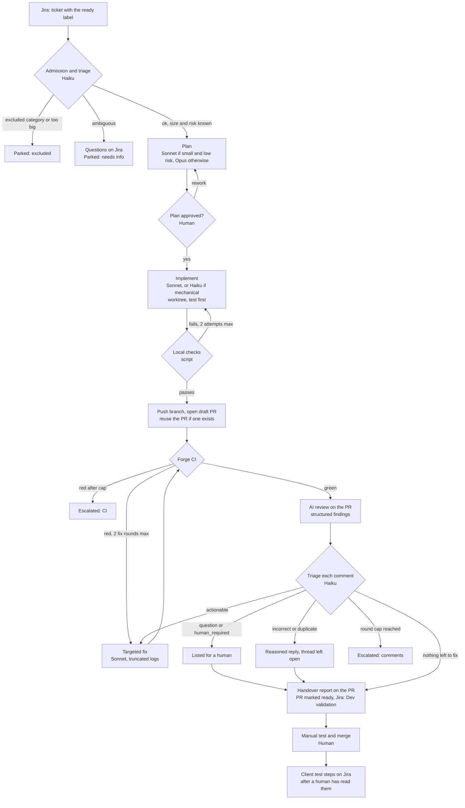

# Comparison of the two plans

This document compares two plans for the same goal: carrying Jira tickets to a pull request that a human tests and merges.

- Plan A is the design in this repository ([architecture.md](architecture.md), [plugin-design.md](plugin-design.md)).
- Plan B is `plan-workflow-agentique-tickets.md`, an implementation plan written as user stories (POC, pilot, industrialisation).

The aim is to keep the good ideas from both, so each plan gets the same treatment: what it does better, and where it is weak. A merged proposal follows.

## At a glance

| Topic | Plan A | Plan B | Better idea |
|-------|--------|--------|-------------|
| Where it runs | Locally, in Claude Code on a developer's machine | A central orchestrator service with isolated, ephemeral runners | A for version 1 (already decided), B later |
| Trigger | A developer runs `/ticket-flow:run SHOP-142` | Jira webhook on the `AI-ready` label, plus a manual replay command | A for version 1. B's replay command matches A's manual run |
| Packaging | A Claude Code plugin installed per repository | Code modules (orchestrator, integrations, agent runtime, profiles) | A |
| Scope of version 1 | Several tickets, split into lots, inline or parallel | One ticket per branch, one family of tickets, no splitting | B |
| Planning | Opus writes a detailed plan for every run | A triage agent outputs summary, acceptance criteria, likely files, risk and ambiguities. No separate plan | Mixed, see below |
| Model routing | Fixed per role: Opus plans, Sonnet and Haiku execute | Start cheap, escalate on ambiguity, risk or failure | Mixed, see below |
| Admission rules | Ready label and a clarity check | Ready label, excluded categories, risk signals, size and duration limits | B |
| Local checks | Lint, types, tests, build before any review | Fast local checks, explicitly not treated as the CI result | Same idea. B is clearer about the limit |
| Forge CI | Only mentioned inside the comment loop | The source of truth, with a bounded fix loop on CI failures | B |
| When the PR opens | After review, as a normal PR | As a draft, before CI, so CI runs on it | B |
| Review | Cold review before the PR, then an external bot on the PR | One independent reviewer after green CI, with structured findings (severity, location, evidence, action). Findings without evidence do not block | B's format. A's independence rules (never a fork, read only) |
| Comment handling | Four categories, fix or reply, two rounds | Five categories (`actionable`, `question`, `duplicate`, `incorrect`, `human_required`), questions and disagreements go to a human, caps per comment and overall, reviewer confirms each fix | B |
| Duplicate runs | Not covered | One run and one PR per ticket, even when events repeat | B |
| Failure states | Caps and a hand-over to a human | Every failure (ambiguous ticket, CI red after max attempts, duplicate event, timeout, missing permission) ends in an explicit, readable state | B |
| Forges | GitHub only, open question | Interface for GitHub and GitLab from the start, built one at a time | Neither in full, see below |
| Measuring success | Cost per ticket through OpenTelemetry | Cost per accepted ticket, CI green rate, human corrections, escalation rate, a benchmark set of past tickets, a definition of done | B for what to measure, A for how |
| Safety | Git guard hook, protected branches, no merge | Least-privilege identities, secrets manager, repository allowlist, spend cap, a way to stop the pilot, audit log without secrets | Both |
| Token savings | Explicit levers: profile and module map, free checks first, caps, prompt cache, scripts for parsing, short reports | Model routing and cost measurement only | A |
| Claude Code tooling | Skills, agents, hooks, Monitor, worktrees, superpowers, all checked against the docs | "Claude Code SDK/CLI", not detailed | A |

## What plan B does better

It cuts version 1 down hard. One repository, one forge, one family of tickets, one ticket per branch. Plan A's own measurement already showed that parallel lots cost more than inline work on small tickets, yet plan A still designs lots and a parallel mode into the first version. B is right to wait until conflicts have been measured.

It treats the forge's CI as the truth. Local checks catch most errors cheaply, but only CI proves the branch works in the real pipeline. Plan A barely mentions CI, and has no loop for fixing a red build.

It opens the PR as a draft, early. CI then runs on the PR, the team can see work in progress, and nobody mistakes it for ready work.

It plans for failure. Duplicate events, timeouts and missing permissions each end in a named state, and the POC has to demonstrate them. Plan A only describes the happy path and the caps.

It has an admission policy. Excluding migrations, authentication and permission changes from the start keeps the riskiest tickets away from the agents. Plan A has nothing on risk.

Its comment handling is safer. Questions and disagreements go to a human instead of being argued by an agent, each comment has its own cap, and the reviewer checks that a fix really addresses the comment.

It defines success. Cost per accepted ticket is a better measure than cost per ticket, because a cheap run that gets rejected costs everything it spent. The definition of done refuses to count opened PRs as success on their own.

## Where plan B is weaker

It needs a service before it can prove anything. A webhook endpoint, a persistent orchestrator, deduplication, a secrets manager and ephemeral runners are a lot to build for a POC, and they conflict with the decision to start locally. Most of that infrastructure answers questions (concurrency, repeated events, multi-client isolation) that a manually triggered local run does not have yet.

It designs a forge interface before there is a second forge. An abstraction drawn from one example usually guesses wrong about the second one. Keeping every forge call in one small script costs less and makes the GitLab port just as cheap when it comes.

It has no planning step and no human gate before code. The triage output is close to a light plan, which is good, but nobody approves it, so a misunderstood ticket only shows up in the diff.

Escalating on failure can cost more than it saves. A cheap model that fails pays for its attempt, then the stronger model pays again for the same work. It works when failures are rare, so it needs measuring, not assuming.

It says nothing concrete about tokens beyond routing. There is no repository map to avoid exploration, nothing on prompt caching, nothing on keeping reports and logs short.

It is unclear about who reviews. "AI review published" and "comments from reviewers" could mean the plan's own reviewer, an external bot, or both. Two AI reviews of the same diff would be paid twice.

It does not mention the existing work: the Claude Code plugin format, the `parallel-tickets` and `watch-pr-reviews` skills, superpowers.

## What plan A does better

It fits the decision to start locally, and ships as a plugin a repository can install, so the flow is reusable from day one without a server.

It is specific about cost. Free checks before any model, a profile and module map instead of exploration, caps on every loop, prompt cache reuse, parsing with `jq` and `gh`, short reports.

It is grounded in the tooling. Agents with a fixed model and restricted tools, worktree isolation, a git guard hook, the Monitor tool, and a list of what is verified and what is not.

It reuses what already works: the two existing skills and superpowers.

It puts a human on the plan, before any code is written.

## Where plan A is weaker

Version 1 is too big. Lots, parallel mode and multi-ticket runs all arrive at once.

Opus plans every ticket, even a one-line fix. For small maintenance tickets that is probably more than they need. This is my estimate and has not been measured.

CI is missing as a gate, there is no CI fix loop, and the PR opens late.

Two reviews of the same diff: the cold review before the PR, then the bot on the PR. If the bot is good, the first one is mostly redundant.

There are no admission rules, no duplicate protection, no named failure states, no definition of done.

The "wrong or cosmetic" comment branch lets an agent reply and resolve a disagreement by itself, which can turn into an argument between two bots.

## Merged proposal

The base stays plan A's: local, a Claude Code plugin, the token levers, the git guard. Plan B supplies the scope of version 1, CI as the gate, the early draft PR, the failure states, the admission rules, the comment categories and the success measures.

This is the proposal as first written. Some parts changed when the decisions below were taken, and the current design is in [architecture.md](architecture.md).

### Taken from plan B

- Version 1 handles one ticket per branch, from one family of maintenance tickets (circumscribed bugs, small changes, tests, documentation), on one repository and one forge. Lots and parallel mode move to a later step, once conflicts have been measured.
- An admission policy in the repository profile: excluded categories (data migrations, authentication, permissions, dependency upgrades), sensitive directories the agents must not touch, and size limits. A ticket that breaks a rule is parked with the reason.
- Triage produces a structured output: summary, acceptance criteria, likely files, risk, ambiguities, size, and a `continue` or `human_required` decision.
- The PR opens as a draft right after the local checks, and the forge's CI is the gate. A red build goes through a targeted fix loop with a cap.
- One run and one PR per ticket. Locally that only needs two checks before starting: an existing run folder for the ticket, and an open PR on its branch (`gh pr list --head <branch>`).
- Named terminal states, written to the run's log: `ready_for_qa`, `parked_needs_info`, `parked_excluded`, `escalated_ci`, `escalated_comments`, `timeout`, `failed_permission`.
- Review findings follow one format: severity, location, evidence, suggested action. A finding without evidence does not block.
- The five comment categories, with questions and disagreements handed to a human. An agent may reply to a comment it thinks is wrong, but it leaves the thread open for a human.
- A cap per comment as well as the overall round cap, and a check that each fix answers its comment.
- Success is measured as cost per accepted ticket, CI green rate, human corrections, escalation rate, on a benchmark set of past tickets, against a written definition of done.
- A spend cap per ticket and a way to stop all runs at once.
- An audit log that never contains secrets.

### Kept from plan A

- Local execution in Claude Code, packaged as a plugin.
- A human approves the plan before any code is written.
- The repository profile with its module map, which plan B's "compact repository context" also asks for.
- The token levers: free checks first, caps everywhere, prompt cache, scripts for parsing, short reports, truncated logs.
- Roles with fixed models and restricted tools, the reviewer's independence (fresh, read only, never a fork), the git guard hook with protected branches.
- Reuse of `parallel-tickets`, `watch-pr-reviews` and superpowers.
- Cost measured through Claude Code's OpenTelemetry metrics, which is how plan B's cost metrics can be collected.

### Changed in both

- Planning model. Neither "Opus always" (A) nor "cheap first, escalate on failure" (B). Triage already estimates size and risk, so it picks the planner: Sonnet for small, low-risk tickets, Opus for the rest or when triage flags ambiguity. The executor follows the same logic. This rule is a guess to test on the benchmark set.
- One AI review, not two. The pre-PR cold review disappears. The AI review runs once, on the draft PR, after green CI, and its comments feed the comment loop. If the team keeps an external bot, that bot is the reviewer. If not, the plugin's own reviewer agent posts its findings on the PR.
- Forges. No interface layer in version 1. Every forge call (open a PR, read CI status, read and answer comments) lives in one script, `forge.sh`, so a GitLab version means rewriting one file.

### Left out for now

- Plan B's webhook, central orchestrator, secrets manager and ephemeral runners. They become relevant when the flow runs without a developer, which the decisions place after version 1. `claude-code-action` or a headless runner would be the natural route then.
- Plan A's lots, parallel mode and multi-ticket runs, until the benchmark shows they pay.

## Decisions taken

1. One ticket per branch: accepted. Maintenance only: rejected. Every kind of ticket goes in, and triage classifies it as a bug, a feature, a technical change or a story. A story gets a split proposal, and the approved split becomes sub-tickets on Jira.
2. The AI reviewer is Claude Code's `/code-review`, run locally in a separate session. The flow posts its findings as threads itself, which works the same on GitLab and GitHub.
3. No excluded category during the pilot. Risk signals raise the planner to Opus and show up in the handover instead.
4. The pilot covers at least one ticket of each kind, listed in [decisions.md](decisions.md). No spend cap for now, cost is measured on every run.
5. Comments go out under the developer's own account in version 1, marked as posted by ticket-flow. There is no non-personal identity yet.

Two more answers changed the proposal. The flow resolves only the threads it fixed and checked, and leaves every other thread open. And GitLab is supported first, GitHub second, both through `forge.sh`.
